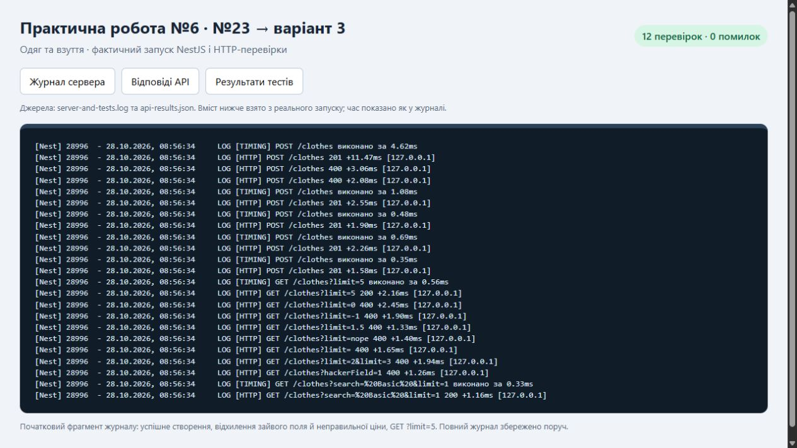
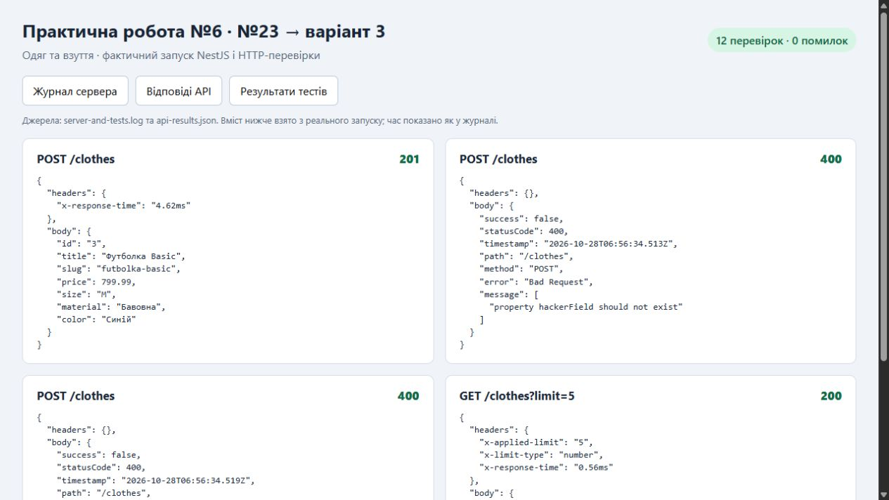
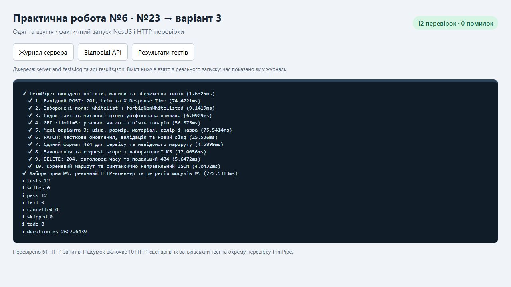

# Практична робота №6 — валідація та обробка запитів у NestJS

**Номер у списку: 23. Варіант: `((23 - 1) % 10) + 1 = 3` — «Одяг та взуття».**

Мета: реалізувати Request Pipeline для каталогу товарів: перевірку DTO, очищення тексту, логування запитів, єдині HTTP-помилки та вимірювання часу відповіді. Виконано всі три рівні завдання.

## Основа роботи

Проєкт адаптовано з реальної практичної №5 із папки `C:\Users\vadim\Desktop\lab5WEB`. Збережено структуру модулів, `HomeModule`, замовлення, `SlugService`, `STORE_CONFIG` (`useValue`), `FEE_CALCULATOR` (`useFactory`), `OnModuleInit` та сервіси зі `Scope.REQUEST`.

Каталог гаджетів замінено на `ClothesModule`, маршрут — `/clothes`, поля — `title`, `price`, `size`, `material`, `color`. Замовлення отримують товари через `ClothesService`. Два початкові товари — демонстраційні дані цієї роботи. Попередню лабораторну не змінено.

## Запуск

Потрібні **Node.js 20+** та npm, оскільки використано NestJS 11 із попереднього проєкту.

```powershell
cd C:\Users\vadim\Desktop\lab6WEB
npm ci
npm run build
npm start
```

Сервер: `http://localhost:3000`. Якщо залежності вже скопійовані, `npm ci` можна пропустити. Інший порт: `$env:PORT = '3001'` перед `npm start`. Завершення сервера — `Ctrl+C`.

Відкрити `requests.http` у VS Code з REST Client та послідовно виконати запити. `productId = 3` відповідає першому створеному товару на чистому сервері. Після інших створень слід підставити фактичний ID з відповіді.

**Дані зберігаються в пам’яті** й скидаються після перезапуску. База даних та браузерний інтерфейс не потрібні для цієї практичної.

## Структура

```text
src/
  main.ts                  # створення та запуск Nest-застосунку
  configure-app.ts         # одна конфігурація для сервера і тестів
  app.module.ts            # модулі та реєстрація middleware
  clothes/
    dto/                   # Create, Update, ListClothesQuery DTO
    clothing.entity.ts     # товар та enum ClothingSize
    clothes.controller.ts  # HTTP-маршрути
    clothes.service.ts     # каталог і початкові дані
    clothes.module.ts      # експорт сервісу для замовлень
  common/
    pipes/trim.pipe.ts
    middleware/http-logger.middleware.ts
    filters/http-exception.filter.ts
    interceptors/timing.interceptor.ts
  home/                    # GET / з практичної №5
  orders/                  # замовлення та розрахунок суми
  shared/                  # спільні провайдери практичної №5
test/api.test.js            # автоматичні перевірки
scripts/verify.js           # перевірка зі збереженням журналу
requests.http              # запити для ручної демонстрації
evidence/                  # фактичні відповіді, журнал і знімки
```

## Рівень 1 — валідація DTO

Залежності `class-validator` та `class-transformer` збережено з попередньої роботи. У глобального `ValidationPipe` увімкнено `whitelist: true`, `forbidNonWhitelisted: true`, `transform: true`.

| Поле | Правила створення |
|---|---|
| `title` | `@IsString()`, `@IsNotEmpty()` |
| `price` | `@IsNumber({ maxDecimalPlaces: 2 })`, `@IsPositive()` |
| `size` | `@IsEnum(ClothingSize)` — `XS`, `S`, `M`, `L`, `XL` |
| `material` | `@IsString()`, `@IsNotEmpty()` |
| `color` | `@IsString()`, `@IsNotEmpty()` |

`UpdateClothingDto` містить ті самі правила та `@IsOptional()` для кожного поля. Порожнє тіло PATCH дозволено. Як передбачає `@IsOptional()`, `null` в оновленні трактується як пропущене значення; сервіс не записує його поверх збереженого поля. У POST усі п’ять полів обов’язкові.

JSON-ціна має бути числом: `799.99`, а не `"799.99"`. Не ввімкнено глобальне неявне перетворення числових рядків у тілах. Для query-параметра `limit` явно використано `@Type(() => Number)`, `@IsInt()`, `@Min(1)` у `ListClothesQueryDto`. Це дозволяє одночасно відхиляти неправильні типи в POST та перетворювати `?limit=5` у число.

## Рівень 2 — TrimPipe та middleware

`TrimPipe` зареєстровано **перед** `ValidationPipe`: рядки очищуються до перевірки `@IsNotEmpty()`. Пайп рекурсивно обходить вкладені об’єкти й масиви, зберігає числові та булеві типи, `null`, `undefined`. Обробляються й query-об’єкти без прототипу, які створює Express 5. Вхідний об’єкт не змінюється.

`HttpLoggingMiddleware` отримує метод, початковий URL та IP, фіксує монотонний час через `performance.now()`, викликає `next()`, а на `res.on('finish')` записує статус і тривалість через `Logger('HTTP')`.

`AppModule implements NestModule` реєструє middleware на всіх маршрутах. Для **NestJS 11 / Express 5** використано іменований wildcard `forRoutes('{*path}')`, що охоплює також `/`. Це еквівалент вимоги про всі маршрути з урахуванням версії встановленого фреймворку.

Тривалість middleware охоплює обробку до завершення відповіді, а інтерцептор вимірює частину конвеєра від свого входу до формування результату. Тому ці два значення можуть відрізнятися.

## Рівень 3 — фільтр та інтерцептор

`GlobalExceptionFilter` із `@Catch(HttpException)` зареєстровано глобально через `app.useGlobalFilters()`. Він повертає однакову структуру для валідації та HTTP-помилок, зокрема 400 і 404:

```json
{
  "success": false,
  "statusCode": 400,
  "timestamp": "<фактичний час у форматі ISO 8601>",
  "path": "/clothes",
  "method": "POST",
  "error": "Bad Request",
  "message": ["property hackerField should not exist"]
}
```

Це опис формату; фактичні відповіді з часом запуску збережено в [api-results.json](evidence/api-results.json). `path` містить також query-рядок, а `message` завжди є масивом. Фільтр перехоплює `HttpException`, як передбачено завданням; інші непередбачені помилки обробляє стандартний механізм NestJS.

`TimingInterceptor` глобально підключено через `app.useGlobalInterceptors()`. У `tap()` він додає `X-Response-Time: <число>ms` до кожної успішної відповіді, включно з 204, та пише повідомлення `TIMING`. Для помилок цей заголовок не гарантується: за умовою обов’язковою є його наявність на успішних відповідях.

## API

| Метод | Маршрут | Результат |
|---|---|---|
| GET | `/` | `Hello World!` |
| GET | `/clothes?search=Basic&limit=5` | масив товарів, пошук та ліміт |
| GET | `/clothes/:id` | товар або 404 |
| POST | `/clothes` | створений товар, 201 |
| PATCH | `/clothes/:id` | часткове оновлення, 200 |
| DELETE | `/clothes/:id` | видалення, 204 |
| POST | `/orders` | замовлення, 201; невідомий товар — 404 |
| GET | `/orders` | список замовлень |

Валідне тіло створення:

```json
{
  "title": "  Футболка Basic  ",
  "price": 799.99,
  "size": "M",
  "material": "  Бавовна  ",
  "color": "  Синій  "
}
```

У відповіді `title` буде `Футболка Basic`, `material` — `Бавовна`, `color` — `Синій`, `slug` — `futbolka-basic`. Збережено заголовки попередньої роботи `X-Request-Id`, `X-Request-Trace-Match`, а на GET каталогу — `X-API-Version`, `X-Service-Status`.

Для демонстрації query-трансформації GET із `limit` повертає також `X-Limit-Type: number` і `X-Applied-Limit`. Значення типу обчислюється в контролері через `typeof query.limit`, а не задане константою.

## Фактичні результати перевірки

```powershell
npm test
```

Для одночасного оновлення журналу й запису відповідей:

```powershell
npm run verify
```

Перевірка збирає проєкт і запускає окремий сервер на вільному локальному порту, надсилає HTTP-запити та закриває його після завершення. Вона не змінює дані сервера, який користувач окремо запустив на порту 3000.

**Перевірено 28.10.2026: 12 тестів пройшли, 0 помилок; виконано 61 HTTP-запит.** Підсумок Node.js включає 10 HTTP-сценаріїв, їх батьківський тест і окремий тест рекурсивного TrimPipe.

| Обов’язкова перевірка | Підтверджений результат |
|---|---|
| Валідний POST із пробілами | 201, очищені поля, `X-Response-Time` |
| `hackerField` у POST | 400, `property hackerField should not exist` |
| `price` як рядок | 400, уніфікована помилка |
| GET `?limit=5` | 200, рівно 5 товарів із 7, тип `number` |
| Обмеження варіанта | 0/від’ємна ціна, неправильний size і порожній матеріал відхиляються |
| PATCH | пропущені поля дозволені, передані значення перевіряються |
| Невідомий товар і маршрут | 404 у спільному форматі |
| Замовлення та request scope | збережені та перевірені |

Усього отримано: 9 відповідей 200, 11 відповідей 201, 1 відповідь 204, 36 очікуваних відповідей 400 та 4 очікувані відповіді 404. Відповіді 400/404 у цих сценаріях підтверджують правильну обробку некоректних запитів.

Джерела доказів: [відповіді API](evidence/api-results.json), [повний журнал сервера і тестів](evidence/server-and-tests.log), [локальний переглядач результатів](evidence/index.html). Переглядач можна відкрити як звичайний HTML-файл.

### Знімки роботи

Нижче — знімки браузерного переглядача, який відображає **фактичний консольний журнал** та JSON-відповіді цього запуску. Текст журналу не редагувався; показано його фрагмент. Значення часу залежать від конкретного запуску.







## Контрольні питання

1. **Порядок Request Pipeline.** Запит проходить middleware, guards, вхідну частину interceptors, pipes, обробник контролера та вихідну частину interceptors. За успіху формується відповідь. Неперехоплений виняток передається відповідному exception filter; фільтри не є обов’язковим завершальним кроком успішного запиту. Вихідна частина вкладених інтерцепторів виконується у зворотному порядку. У цьому проєкті власні guards не потрібні й не реалізовані.

2. **`whitelist` та `forbidNonWhitelisted`.** Перша опція визначає дозволені DTO-властивості за декораторами валідації, друга відхиляє невідомі поля з 400 замість їх мовчазного видалення. Це зменшує ризик mass assignment, коли клієнт намагається записати службові поля. Ці опції не замінюють авторизацію.

3. **`transform: true`.** Дає змогу передати обробнику екземпляр DTO та перетворювати параметри з урахуванням метаданих. HTTP query і path спочатку є текстом. Для числового поля query DTO тут явно застосовано `@Type(() => Number)`; `transform: true` сам по собі не означає неявне перетворення всіх числових рядків у вкладених DTO.

4. **Middleware та Interceptor.** Middleware працює з `req`, `res`, `next()` до обробника й підходить для загального HTTP-логування. Interceptor має `ExecutionContext` і `CallHandler`, обгортає виконання маршруту та працює з RxJS-потоком; він підходить для вимірювання часу, кешування чи перетворення відповіді. Middleware бачить завершення відповіді через `finish`, навіть якщо маршрут повернув HTTP-помилку.

5. **`PipeTransform`.** Інтерфейс описує `transform(value, metadata)`: `value` — поточне значення аргументу, `metadata` — його тип (`body`, `query`, `param`, `custom`), клас і назва параметра за наявності. Пайп повертає очищене/перетворене значення або викидає виняток.

6. **`@Catch(HttpException)`.** Обмежує тип винятків, які обробляє фільтр. `host.switchToHttp().getRequest<Request>()` та `.getResponse<Response>()` надають платформні Express-об’єкти. Статус отримується через `exception.getStatus()`, деталі — через `getResponse()`.

7. **Вкладені DTO.** Потрібен окремий клас вкладеного DTO, на його полі — `@ValidateNested()` і `@Type(() => NestedDto)`, для масиву — `@ValidateNested({ each: true })` разом із правилами масиву. `ValidationPipe` із `transform: true` створить екземпляри класів для коректної валідації. Це пояснення контрольного питання: варіант 3 має лише плоскі поля, вкладений DTO у каталозі не потрібен.

8. **RxJS `tap()`.** Виконує побічну дію під час проходження значення потоком, не замінюючи його. Тут він додає заголовок і записує час; тіло відповіді залишається результатом контролера. Для спостереження помилок можна задати обробник `error`, а для дії при будь-якому завершенні потоку застосовують `finalize()`.

## Порядок демонстрації

1. Запустити сервер і показати початкові GET `/clothes` та `/`.
2. Виконати перші чотири запити з `requests.http`; показати очищений текст, `X-Response-Time`, відхилення зайвого поля, формат помилки та тип `limit`.
3. Показати неправильний розмір і порожній матеріал, PATCH, замовлення та 404.
4. Показати повідомлення `HTTP` / `TIMING` у терміналі та виконати `npm run verify`.
5. Пояснити порядок пайпів і залежність `OrdersModule` від `ClothesModule`.

## Стан звітності

Код, README, запити та докази запуску підготовлено локально. Публікація у віддалений Git-репозиторій і усний захист ще не виконані. URL репозиторію не надано; після вибору власного репозиторію потрібно завантажити туди цей проєкт, виключивши `node_modules/` і `dist/` за `.gitignore`. Скриншоти, журнал і `api-results.json` потрібно залишити для звіту.
